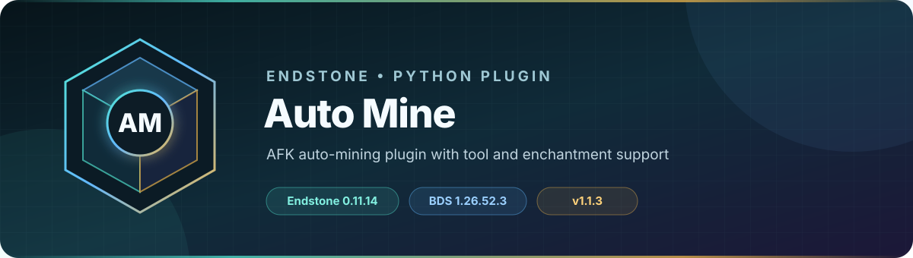

<!-- endstone-professional-header:start -->
<p align="center">
  
</p>

<p align="center">
  <a href="https://github.com/TheNINJALLO/endstone-auto-mine/actions/workflows/wheel-release.yml"></a>
  <a href="https://github.com/TheNINJALLO/endstone-auto-mine/releases/latest"></a>
</p>

<p align="center">
  
  
  
  =3.11" src="https://img.shields.io/badge/Python-%3E=3.11-3776AB?style=flat-square&amp;logo=python&amp;logoColor=white">
</p>

<p align="center">
  <strong>AFK auto-mining plugin with tool and enchantment support.</strong>
</p>

<p align="center">
  <a href="#what-it-does">What it does</a> &bull;
  <a href="#how-to-use">How to use</a> &bull;
  <a href="#commands-and-permissions">Commands</a> &bull;
  <a href="#install">Install</a> &bull;
  <a href="https://github.com/TheNINJALLO/endstone-auto-mine/releases">Releases</a>
</p>

## Overview

AFK auto-mining plugin with tool and enchantment support. This release is aligned with Endstone 0.11.14 and Minecraft Bedrock Dedicated Server 1.26.52.3, and is distributed as a Python wheel for direct installation in an Endstone server.

## What it does

- Mines a cuboid selection layer by layer while the player remains online.
- Uses the held pickaxe, respects durability and supported enchantments, and reports live progress.
- Stops safely when requested or when the session can no longer continue.

## How to use

1. Grant access with the vanilla command `/tag <player> add automine`.
2. Have the player hold a pickaxe and run `/automine` with two opposite corners of the target cuboid.
3. Check progress with `/automine status` and end the job with `/automine stop`.

## Commands and permissions

| Command / usage | What it does | Access |
|---|---|---|
| `/automine <x1: int> <y1: int> <z1: int> <x2: int> <y2: int> <z2: int>`<br>`/automine stop`<br>`/automine status` | Auto-mine an area using your pickaxe | Scoreboard tag `automine` |

## Compatibility

| Component | Supported version |
|---|---|
| Endstone | `0.11.14` |
| Endstone API | `0.11` |
| Bedrock Dedicated Server | `1.26.52.3` |
| Python | `>=3.11` |
| Plugin release | `v1.1.4` |

## Install

Download the wheel from the matching GitHub release:

```bash
gh release download v1.1.4 --repo TheNINJALLO/endstone-auto-mine --pattern "*.whl"
```

Copy the downloaded wheel into the server's `plugins/` directory, remove any older wheel for the same plugin, and restart Endstone.

> [!IMPORTANT]
> Use Endstone `0.11.14` with BDS `1.26.52.3`. Back up worlds and plugin data before upgrading a production server.

## Configuration and secrets

Runtime databases, logs, local `.env` files, server directories, and root `config.toml` files are excluded from source releases. When an example configuration is provided, copy it locally and keep live tokens, passwords, webhook URLs, and server identifiers out of Git.

## Release automation

Every `v*` tag runs [the wheel release workflow](.github/workflows/wheel-release.yml), builds the package in a clean GitHub runner, stores the wheel as a workflow artifact, and attaches it to the matching GitHub release.
<!-- endstone-professional-header:end -->

---

## Project guide

AFK auto-mining plugin for Endstone that allows tagged players to automatically mine a designated area using their equipped pickaxe.

## Features

- **Tag-gated access**: Requires `automine` player tag
- **Pickaxe required**: Must hold a pickaxe to start mining
- **Full enchantment support**:
  - **Silk Touch**: Drops the block itself
  - **Fortune**: Enhanced drops from ores
  - **Efficiency**: Faster mining speed
  - **Unbreaking**: Reduced durability loss
- **Durability tracking**: Stops automatically when pickaxe breaks
- **Layer-by-layer mining**: Top-down, efficient pattern

## Commands

| Command | Description |
|---------|-------------|
| `/automine <x1> <y1> <z1> <x2> <y2> <z2>` | Start mining the specified area |
| `/automine stop` | Stop current mining session |
| `/automine status` | Check mining progress |

### Example
```
/automine 100 60 200 150 40 250
```
This mines a 51x21x51 area from (100, 60, 200) to (150, 40, 250).

## Installation

1. Build the plugin:
   ```
   py -3.11 -m build
   ```

2. Copy the `.whl` file from `dist/` to your server's `plugins/` folder.

3. Restart/reload the server.

## Usage

1. Grant the `automine` tag to a player:
   ```
   /tag <player> add automine
   ```

2. Hold a pickaxe and run the automine command with coordinates.

3. Stay AFK while mining proceeds automatically.

## Requirements

- Endstone 0.11.9+
- Python 3.9+
